<p align="center">
  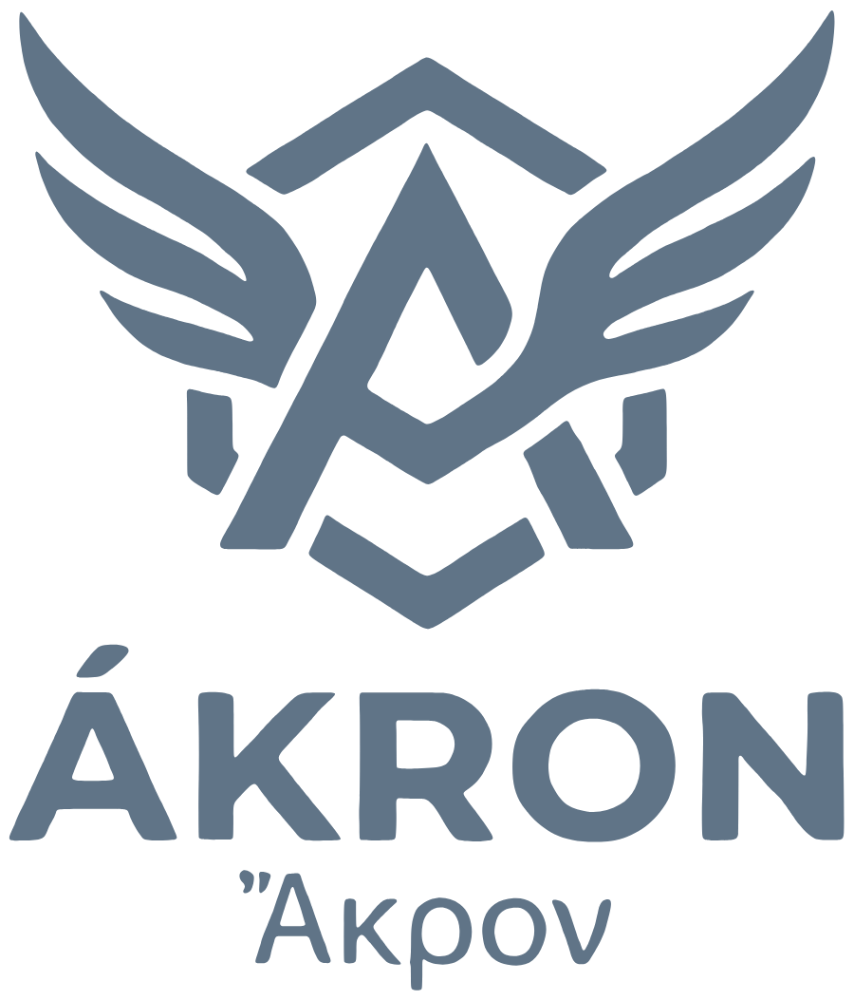
</p>

<h1 align="center">ÁKRON — aplicativo</h1>

<p align="center"><em>Sistema de Monitoramento Industrial · Flutter</em></p>

Aplicativo em **Flutter** (Android, iOS, web e desktop) do sistema ÁKRON: painel, gráficos de
sensores em tempo real, alertas, relatórios e gestão de sensores e usuários — com **tema claro e
escuro**. Ele conversa com o sistema web em PHP/MySQL (repositório
[`tcc`](https://github.com/Nananilda/tcc)) por meio de uma API JSON.

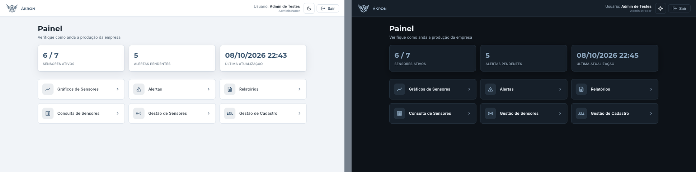

---

## Sumário

1. [Telas](#telas)
2. [Como rodar](#como-rodar)
3. [Como o app se conecta ao banco de dados](#como-o-app-se-conecta-ao-banco-de-dados)
4. [Contas de teste](#contas-de-teste)
5. [Tema claro e escuro](#tema-claro-e-escuro)
6. [Identidade visual](#identidade-visual)
7. [Estrutura do código](#estrutura-do-código)
8. [Padrão de nomes](#padrão-de-nomes)
9. [Testes](#testes)
10. [Notas por plataforma](#notas-por-plataforma)
11. [Limitações conhecidas e próximos passos](#limitações-conhecidas-e-próximos-passos)

---

## Telas

Cada imagem mostra o **tema claro** (esquerda) e o **tema escuro** (direita). Há também as
versões de celular em [`docs/capturas/celular`](docs/capturas/celular).

| Tela | Captura |
|------|---------|
| Login (com o status do servidor e o botão de tema) | 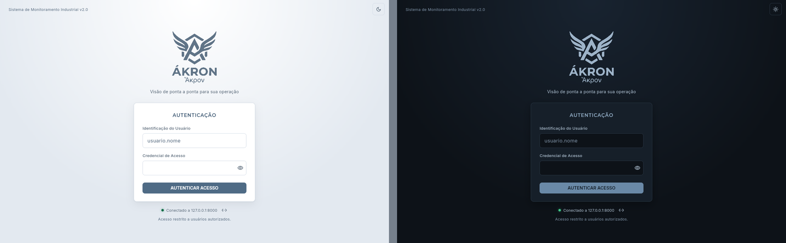 |
| Endereço do servidor (botão "Servidor" do login) | 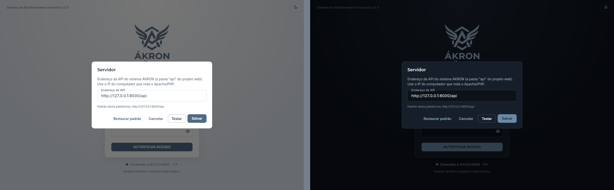 |
| Painel |  |
| Gráficos de sensores (atualiza a cada 15 s) | 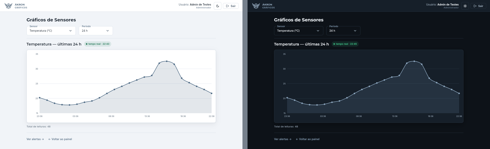 |
| Alertas | 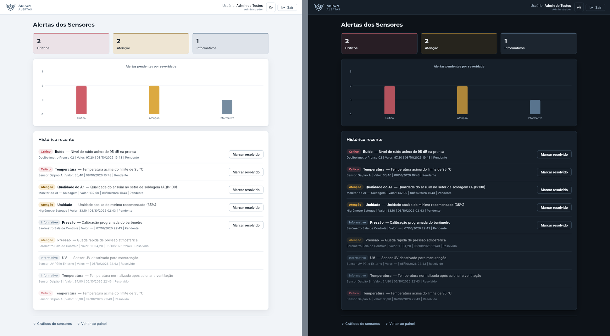 |
| Relatório de qualidade ambiental | 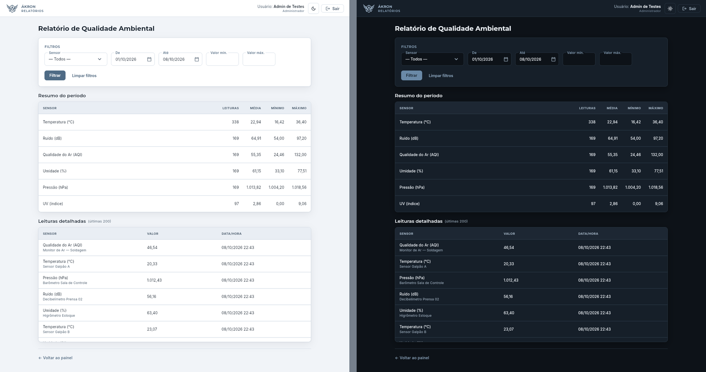 |
| Consulta de sensores | 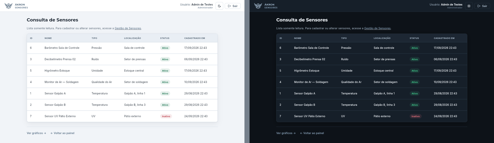 |
| Gestão de sensores (administrador) | 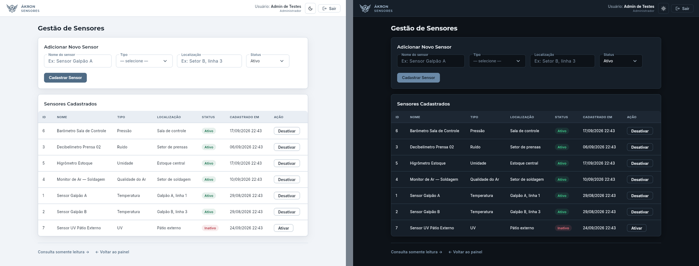 |
| Gestão de usuários | 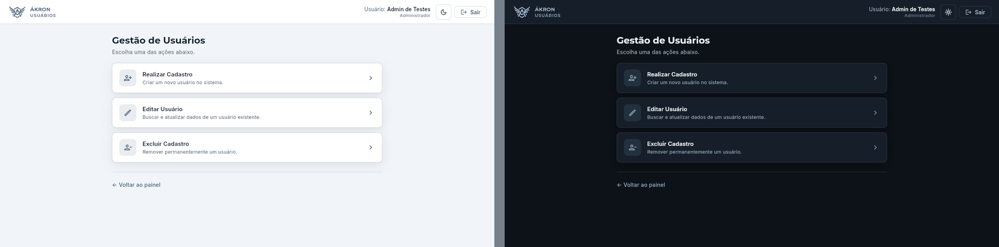 |
| Cadastro de usuário | 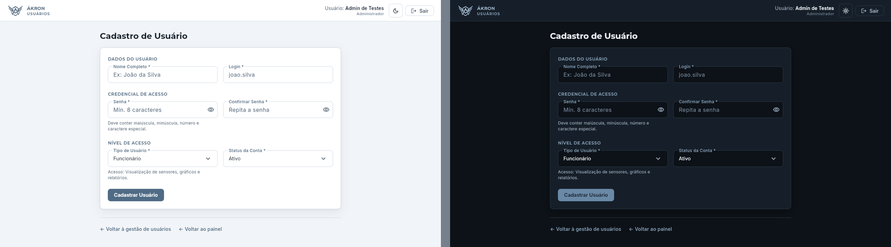 |
| Editar usuário | 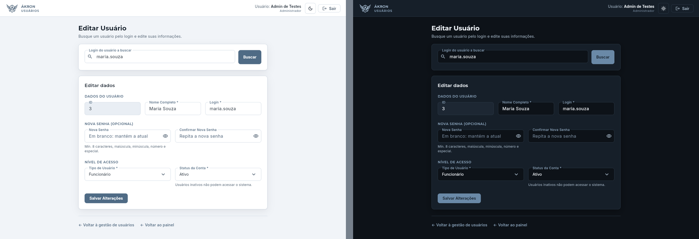 |
| Excluir usuário (confirmação em duas etapas) | 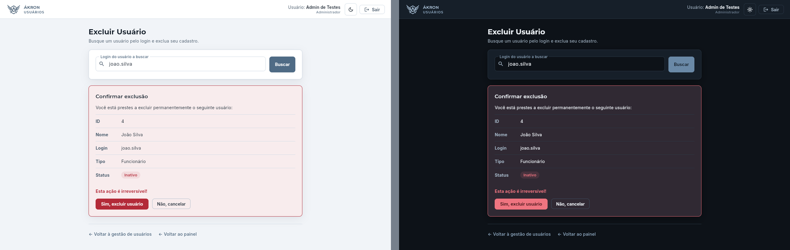 |
| Painel do funcionário (sem as áreas de administração) | 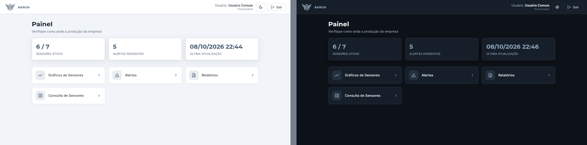 |

---

## Como rodar

### Requisitos

- **Flutter com Dart 3.12 ou mais novo** — testado com Flutter 3.47.7
- O **sistema web em PHP/MySQL** rodando em algum lugar da rede (veja o README do repositório `tcc`)

### Passo a passo

```bash
flutter pub get
flutter run                      # escolha o aparelho/emulador, ou: flutter run -d chrome
```

Na primeira abertura, **toque em "Servidor"** na tela de login e informe o endereço da pasta
`api` do sistema web:

| Onde o app roda | Endereço da API (exemplo) |
|-----------------|---------------------------|
| Emulador Android → PHP no mesmo PC | `http://10.0.2.2/tcc/api` |
| Celular físico, desktop ou web na mesma rede | `http://192.168.0.10/tcc/api` (IP do PC que roda o PHP) |
| PHP embutido (`php -S 0.0.0.0:8000` na raiz do projeto web) | `http://IP-DO-PC:8000/api` |

O botão **Testar** confirma que o servidor *e o banco de dados* respondem, e **Salvar** guarda o
endereço no aparelho. (Isso resolve o problema do laboratório, em que o IP do servidor muda a cada aula
— antes ele ficava fixo no código.)

Também é possível definir o endereço **na compilação**, sem mexer em código:

```bash
flutter run --dart-define=API_BASE_URL=http://192.168.0.10/tcc/api
flutter build web --release --dart-define=API_BASE_URL=http://192.168.0.10/tcc/api
```

Ordem de prioridade: endereço salvo em "Servidor" → `--dart-define` → padrão da plataforma
(`http://localhost/tcc/api`; no Android, `http://10.0.2.2/tcc/api`).

> **Android e iOS:** o servidor do laboratório costuma usar `http://` (sem HTTPS). Por isso o app
> já vem liberado para HTTP (`usesCleartextTraffic` / `NSAppTransportSecurity`). **Em produção, use
> HTTPS e remova essas liberações** (veja [Notas por plataforma](#notas-por-plataforma)).

---

## Como o app se conecta ao banco de dados

```
 App Flutter ──HTTP/JSON──▶ API PHP (pasta api/ do site) ──PDO──▶ MySQL (banco_tcc)
```

O aplicativo **nunca fala direto com o MySQL**: quem consulta o banco é o PHP, e o app usa a API
(`lib/services/api_service.dart`). É o desenho correto por três motivos: a senha do banco não
fica dentro do aplicativo, as regras (validação, permissões) valem igualmente para o site e para o
app, e o MySQL não precisa ficar exposto na internet. Por isso a dependência `mysql_client_plus`,
que existia no `pubspec.yaml` mas não era usada, foi **removida**.

- **Login:** `POST api/login.php` devolve um `token`; o app o envia em todas as chamadas seguintes
  (`Authorization: Bearer …`). Se o servidor responder 401 (sessão de 2 h vencida, conta
  inativada, etc.), o app volta ao login com um aviso.
- **O que faltava:** a versão anterior já chamava a API, mas a pasta `api/` **não existia** no
  repositório do sistema web, então nada funcionava de verdade. Ela foi criada (e testada — 73
  verificações) no repositório `tcc`; a lista de endpoints está no README de lá.
- **Todas as ações** do app gravam no banco de verdade: cadastrar/ativar/desativar sensores,
  resolver alertas, cadastrar/editar/excluir usuários.
- **Erros amigáveis:** servidor fora do ar, endereço errado, resposta inesperada e tempo esgotado
  (12 s) viram mensagens em português, sem travar o app.

---

## Contas de teste

Criadas pelos scripts SQL do repositório `tcc` (`schema.sql` e `dados_exemplo.sql`).

| Login | Senha | Perfil |
|-------|-------|--------|
| `admin` | `Admin@123` | Administrador (acesso total) |
| `usuario` | `Usuario@123` | Funcionário (consulta) |
| `maria.souza` | `Usuario@123` | Funcionário |
| `joao.silva` | `Usuario@123` | Funcionário — conta **inativa** (o login é recusado) |

---

## Tema claro e escuro

- O app **acompanha o modo do aparelho** (claro/escuro) até a pessoa tocar no botão de sol/lua
  (na barra superior e na tela de login); a partir daí a escolha fica **salva no aparelho**
  (`shared_preferences`) e vale na próxima abertura.
- Todas as cores vêm de **uma única fonte**, `lib/theme/cores.dart` (`AkronCores`, uma
  `ThemeExtension`). Os nomes espelham as variáveis CSS do site (`fundoCard` ↔ `--cor-fundo-card`),
  então site e app têm a mesma paleta, nascida do azul-ardósia da logo.
- `lib/theme/tema.dart` traduz esses tokens para o Material 3 (campos, botões, tabelas, diálogos…):
  `AkronTema.claro` e `AkronTema.escuro`.
- Nas telas, nunca se escreve cor fixa: `final c = context.cores;` → `c.fundoCard`, `c.textoSuave`…
  Para mudar uma cor da marca, edite `cores.dart` e os dois temas e todas as telas acompanham.
- A troca de tema é animada, e os gráficos (`fl_chart`) usam as cores `grafico*` do tema.
- Contraste conferido por teste automático (WCAG AA — texto ≥ 4,5:1; logo ≥ 3:1), nos dois temas.

---

## Identidade visual

- **Logo e nome ÁKRON** em `assets/images/` (símbolo, nome e versão completa). As imagens são
  *máscaras brancas* com transparência: o widget `AkronLogo` as pinta com a cor da marca do tema atual.
- **Ícone do app** (Android, iOS, macOS, Windows e web) e **nome "ÁKRON"** configurados em cada plataforma.
- **Tipografia:** Montserrat (títulos) e Inter (texto), embutidas em `assets/fonts/`
  (funcionam sem internet; licença OFL ao lado dos arquivos).
- Na web há uma **tela de abertura** com a logo, no tema do aparelho, até o app carregar.
- Arte original em alta resolução: `docs/identidade/`.

---

## Estrutura do código

```
lib/
├── main.dart                 Ponto de entrada (AkronApp): estado, tema, rotas e idioma pt-BR
├── router.dart               Rotas (go_router) e regras de acesso: login obrigatório, áreas de admin
├── config/api_config.dart    Endereço da API (editável no app, --dart-define ou padrão da plataforma)
├── services/api_service.dart Cliente HTTP da API (token Bearer, tempo limite, erros amigáveis)
├── state/
│   ├── app_state.dart        Sessão + dados (provider): login, sensores, alertas, usuários, relatórios
│   └── tema_controller.dart  Escolha do tema (sistema/claro/escuro) salva no aparelho
├── models/                   Sensor, Alerta, Leitura, Usuario, ResumoPainel (lêem o JSON da API)
├── theme/                    cores.dart (AkronCores) e tema.dart (AkronTema.claro / .escuro)
├── screens/                  Uma pasta por assunto: auth, dashboard, sensores, alertas, relatorios, usuarios
└── widgets/                  Peças reutilizáveis: TelaPadrao, Topbar, AkronLogo, SectionCard, TabelaDados,
                              FeedbackBox, StatusBadge, CampoSelecao, CampoSenha, BotaoPrincipal/Perigo…
```

As telas de dados só pedem coisas ao `AppState` (`context.read<AppState>().carregarAlertas()`);
elas nunca montam requisições. Os `widgets/` evitam repetição: toda tela autenticada usa
`TelaPadrao` (barra superior + área rolável centralizada) e todo formulário usa os mesmos campos,
botões e caixas de mensagem — e as mensagens de sucesso/erro rolam a tela até elas, para que
apareçam mesmo em celulares.

---

## Padrão de nomes

- **Arquivos:** `snake_case.dart`; **classes:** `PascalCase`; **membros:** `camelCase`.
- **Domínio em português**, igual ao sistema web: `Sensor`, `Alerta`, `Usuario`, `StatusConta`,
  `carregarAlertas()`, `cadastrarUsuario()`.
- Telas terminam em `Screen` (`GestaoSensoresScreen`); o que é do app inteiro leva o prefixo `Akron`
  (`AkronApp`, `AkronCores`, `AkronTema`, `AkronLogo`).

| Antes | Depois |
|-------|--------|
| Todo o código dentro de `lib/TCC/` | `lib/config`, `models`, `screens`, `services`, `state`, `theme`, `widgets` |
| `lib/main_original.dart` (cópia antiga do `main`) | removido |
| `IndustrialOsApp`, "IndustrialOS — Usuários" | `AkronApp`, barra com a logo ÁKRON + nome da seção |
| `AppColors` / `app_theme.dart` (só tema escuro) | `AkronCores` + `AkronTema.claro/escuro` |
| `Topbar(titulo: 'IndustrialOS — …')` | `Topbar(secao: 'Usuários')` |
| `Scaffold` + `SafeArea` + `ScrollView` + `ConstrainedBox` repetidos em cada tela | `TelaPadrao` |
| Emojis em botões e menus (➕ ✏️ 🗑️ ✔) | ícones do Material |
| `ApiConfig.baseUrl` fixo no código (IP do laboratório) | endereço editável no app (botão "Servidor") |
| Menu apontava para `/usuarios/cadastro`, rota que não existia | rota registrada e tela de cadastro refeita |
| `DropdownButtonFormField(value: …)` (descontinuado) | `CampoSelecao`, controlado e com validação |

---

## Testes

```bash
flutter analyze      # análise estática: sem avisos
flutter test         # 79 testes
```

| Arquivo | O que cobre |
|---------|-------------|
| `modelos_test.dart` | leitura do JSON da API (números como texto, valores ausentes, enums desconhecidos) |
| `cores_test.dart` | contraste WCAG AA dos dois temas e consistência dos tokens |
| `api_config_test.dart` | normalização e validação do endereço do servidor |
| `app_state_test.dart` | login, token Bearer, sessão expirada (401), permissões de administrador, cadastro/edição/exclusão |
| `telas_test.dart` | o app inteiro rodando: login, tema (e persistência), painel, menus por perfil, fluxos de usuários |
| `telas_dados_test.dart` | alertas, sensores, gráficos e relatório — em computador e em celular, claro e escuro |

Os testes usam um **servidor falso** (`test/apoio/servidor_falso.dart`) que imita a API PHP, então rodam
sem rede nem banco. Eles já encontraram problemas reais durante o desenvolvimento (por exemplo, um
cartão com cantos arredondados e bordas de cores diferentes, que quebra a pintura no Flutter).

---

## Notas por plataforma

O app foi **executado e capturado no Flutter Web** (Chromium) contra o sistema PHP/MySQL de verdade,
nos dois temas e em tela de computador e de celular; os testes automáticos cobrem a lógica e as telas.
As demais plataformas receberam nome, ícone e permissões, **mas não foram compiladas neste
ambiente** — confira o primeiro `flutter run` em cada uma.

| Plataforma | O que foi ajustado |
|------------|--------------------|
| **Android** | nome "ÁKRON", ícones, permissão `INTERNET` e `usesCleartextTraffic` (HTTP do laboratório) |
| **iOS** | nome "ÁKRON", ícones e `NSAppTransportSecurity` (HTTP do laboratório) |
| **macOS** | nome, ícones e permissão `com.apple.security.network.client` (sem ela o app não acessa a rede) |
| **Windows / Linux** | título da janela "ÁKRON", ícone e informações do executável |
| **Web** | título, descrição, `lang="pt-BR"`, cor do navegador por tema, tela de abertura e `manifest.json` (instalável) |

Os identificadores dos pacotes continuam `com.example.*` (padrão do `flutter create`). **Troque-os
antes de publicar nas lojas** (Android: `applicationId` em `android/app/build.gradle`; iOS/macOS:
Bundle Identifier no Xcode).

---

## Limitações conhecidas e próximos passos

- A sessão dura 2 h; não há "manter conectado" nem renovação automática do token.
- O token fica só em memória: fechar o app exige novo login (escolha deliberada — nada sensível é gravado no aparelho).
- Os gráficos atualizam por consulta periódica (a cada 15 s), não por *push*.
- Alertas não geram notificação no celular.
- Em produção: HTTPS e restrição de CORS no servidor; remover as liberações de HTTP em Android/iOS.

---

## Créditos e licenças

- Fontes [Inter](https://rsms.me/inter/) e [Montserrat](https://github.com/JulietaUla/Montserrat) — SIL Open Font License 1.1
  (`assets/fonts/LICENCA-*-OFL.txt`).
- Logo e nome **ÁKRON**: identidade visual do projeto.
